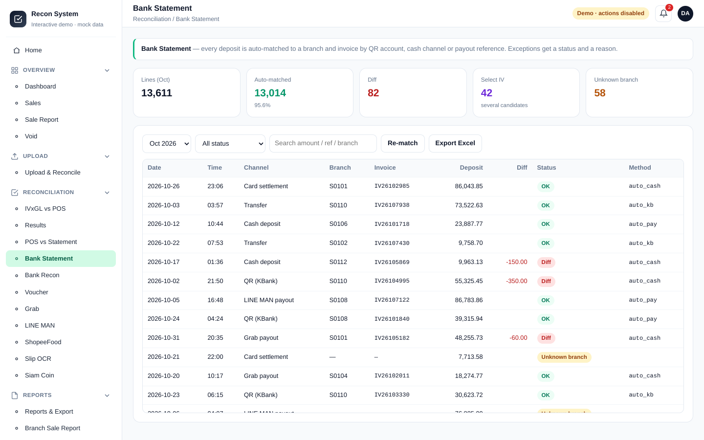
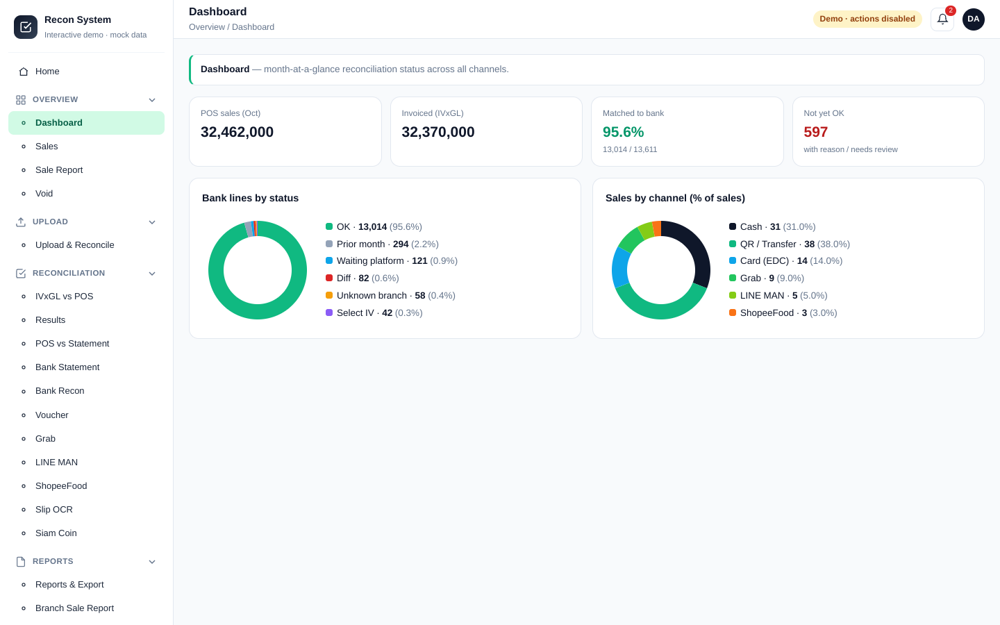
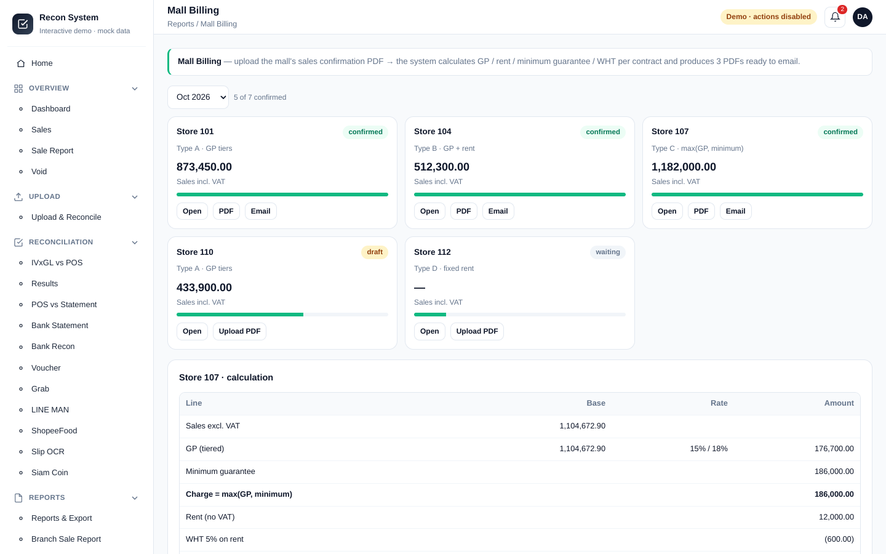
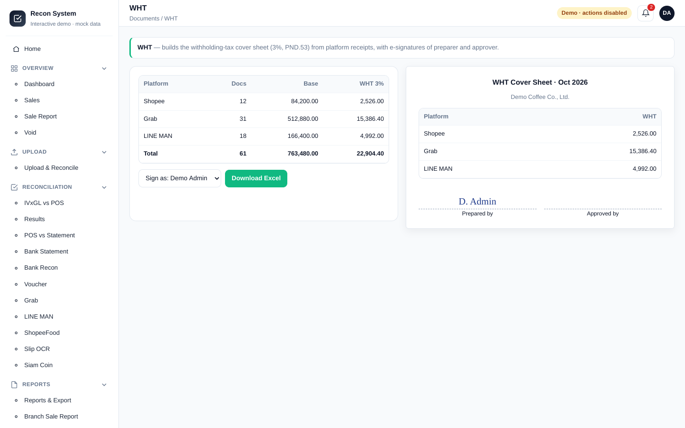

# Case Study: Multi-Branch Reconciliation System

> Internal web app for a Thai F&B chain (150+ branches) that automates bank reconciliation, platform settlements, tax documents and mall billing.
> *Source code and company data are private. Screenshots use masked or sample data.*

### ▶ [Try the interactive demo](https://toeiintp1942.github.io/reconciliation-case-study/)
Click through every menu (41 screens) with mock data — buttons are disabled.

**Role:** Sole designer & builder — requirements, accounting logic, data model, testing, deployment, security, backup
**Built with:** Python, Flask, SQLAlchemy, SQLite, pandas, openpyxl, headless-browser PDF, OCR · AI-assisted development
**Users:** Accounting / AR team (Thai & English UI)

---

## 1. The problem

Every month the AR team had to tie together money from many channels:

- **Bank statements** — thousands of deposits per month from 150+ branches (cash, transfers, QR)
- **POS sales & tax invoices** for every branch, every day
- **Delivery platforms** — Grab, LINE MAN, ShopeeFood payouts net of commission
- **Vouchers, gift cards and coin redemptions**
- **Mall billing** — GP %, fixed rent, minimum guarantees, land tax, WHT — different per contract

All of this was done by hand in Excel. It was slow, hard to audit, and errors were found late.

## 2. What I built

| Module | What it does |
|---|---|
| **Bank Statement matching** | Auto-matches each deposit to branch + invoice by account, cash channel, payment reference; flags `Diff`, `Unknown branch`, `Prior month`, `Waiting for platform` |
| **IV × GL vs POS** | Compares tax invoices with POS sales by branch/day |
| **Delivery platforms** | Imports Grab / LINE MAN / ShopeeFood reports and reconciles payouts |
| **Slip OCR** | Reads payment-slip images and checks them against transactions |
| **Mall Billing** | Calculates GP / rent / minimum guarantee per contract type, produces summary + receipt + sales report PDFs, emails them to the mall |
| **Tax documents** | WHT cover sheets and sales-tax filing covers with e-signatures |
| **Branch reports** | Splits daily sales by branch and emails each branch automatically |
| **Sales dashboard, Void report, audit export** | Management view and audit trail |

## 3. Results

| Metric | Value |
|---|---|
| Bank transactions processed | **61,000+** (Jan–Nov 2026) |
| Monthly volume (Oct 2026) | **~13,600** transactions |
| Auto-matched in Oct 2026 | **95.6%** — the rest are flagged with a reason (prior month, waiting for platform, diff) |
| Payment slips read by OCR | **159,000+** |
| Branches covered | **150+** |
| Daily reconciliation time | **2–3 hours → ~15 minutes** (≈ 90% less) |

## 4. How I worked

1. **Requirements from real work** — I am the user, so each rule came from an actual month-end problem.
2. **Mockups before UI changes** — compared options, chose the simplest.
3. **Test against real numbers** — every calculation was checked against source documents (e.g. mall invoices, platform statements) before going live.
4. **Safe deployment** — backup before every change, small releases, version history in Git.

## 5. Security & reliability

- Role-based permissions, audit log of edits and downloads, inactive users blocked
- Self-run security review of the codebase → fixed TLS verification, path-traversal, input validation, zip-bomb limits
- Email credentials never stored — each user enters a temporary code kept in memory for 2 hours
- **Weekly encrypted (AES-256) off-site backup** to a private repository, with integrity check and retention of 6 copies

## 6. What I learned

- Accounting knowledge is the hard part — the code is only as good as the matching rules.
- Small, tested changes beat big rewrites in a system people use every day.
- Using AI well means owning the design, the tests and the final decision.

---

## Screenshots (mock data)

